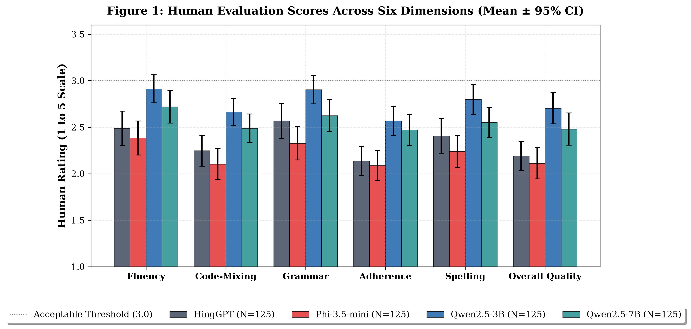
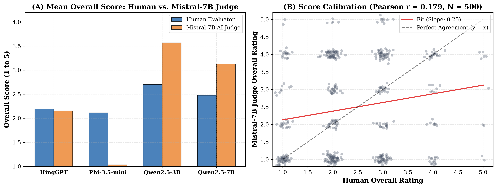
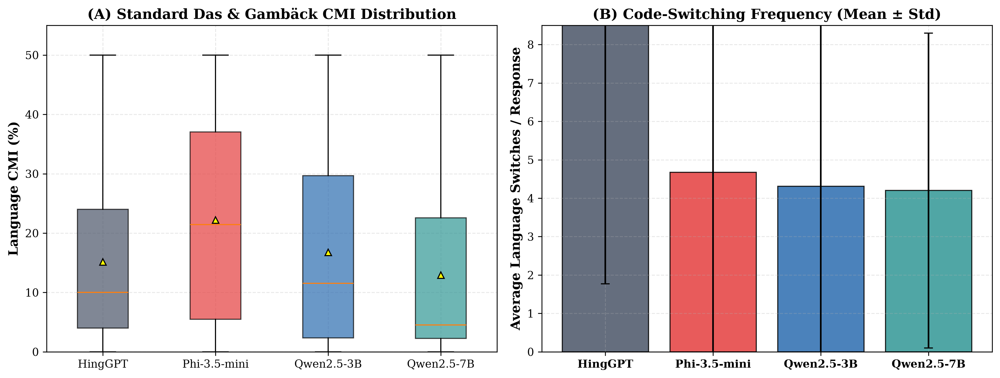
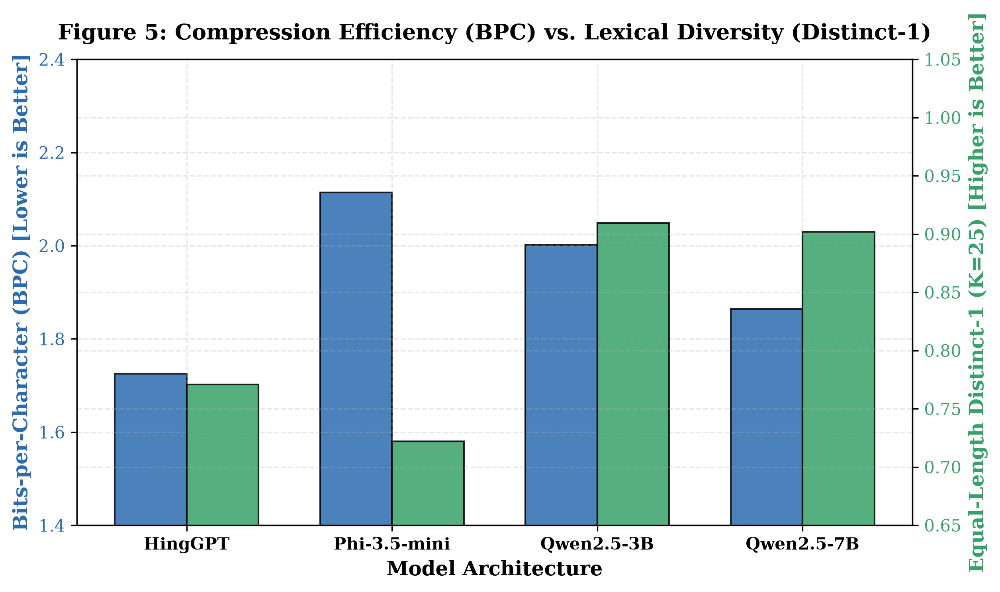
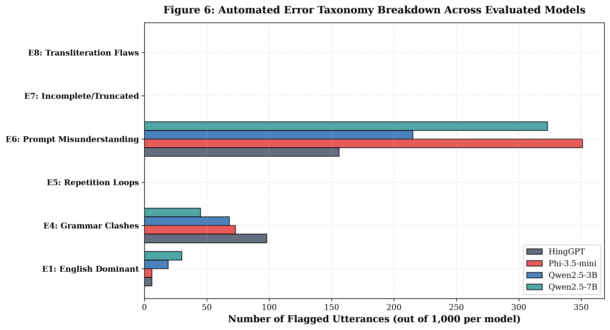
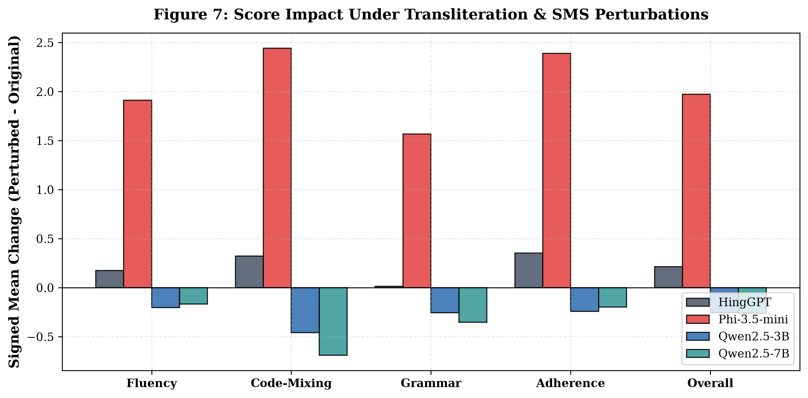
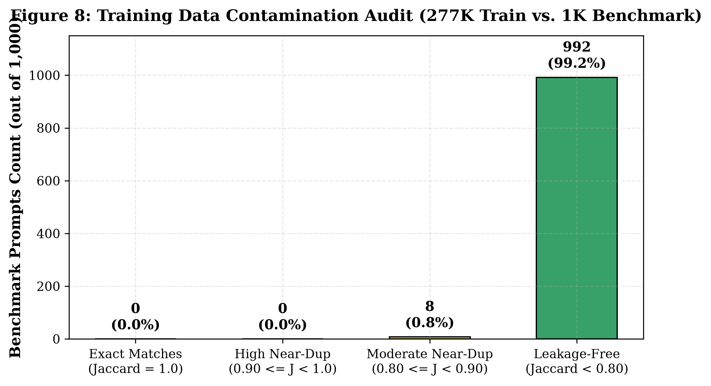

<<<<<<< HEAD
# HinglishEval: A Multi-Dimensional Benchmark & LLM-as-a-Judge Reliability Study for Hindi-English Code-Mixed Generation

> **A contamination-audited evaluation framework establishing the reliability boundaries of LLM evaluators and benchmarking open-weight models on real-world Hindi-English (Hinglish) conversational text.**

[](LICENSE)
[](https://www.python.org/)
[](paper.md)
[](https://huggingface.co/kancharla-vyshnavi)
[](https://github.com/kancharla-vyshnavi/A-Multi-Dimensional-Benchmark-of-LLMs-for-Hindi-English-Code-Mixed-Generation/pulls)
=======
# HinglishEval: A Multi-Dimensional Benchmark of LLMs for Hindi–English Code-Mixed Generation

<p align="center">
  <strong>Evaluating Fluency, Code-Mixing Naturalness, Grammar, Prompt Adherence, Spelling, and Overall Quality</strong>
</p>

<p align="center">
  
  
  
  
  
</p>

## Table of Contents

- [Overview](#overview)
- [Research Motivation](#research-motivation)
- [Objectives](#objectives)
- [Benchmark at a Glance](#benchmark-at-a-glance)
- [Models Evaluated](#models-evaluated)
- [Dataset Preparation](#dataset-preparation)
- [System Architecture](#system-architecture)
- [Evaluation Framework](#evaluation-framework)
- [Human Evaluation](#human-evaluation)
- [Automated-Judge Evaluation](#automated-judge-evaluation)
- [Statistical Analysis](#statistical-analysis)
- [Error Analysis](#error-analysis)
- [Linguistic Analysis](#linguistic-analysis)
- [Checkpoint and Diversity Metrics](#checkpoint-and-diversity-metrics)
- [Repository Structure](#repository-structure)
- [Installation](#installation)
- [Running the Project](#running-the-project)
- [Human-Validation Interface](#human-validation-interface)
- [Results and Discussion](#results-and-discussion)
- [Reproducibility](#reproducibility)
- [Limitations](#limitations)
- [Citation](#citation)
- [License](#license)
- [Acknowledgements](#acknowledgements)
>>>>>>> c93918a551cee20a3fe32909e3c2dcd1af9cb4ac

## Overview

<<<<<<< HEAD
## ⚡ Headline Results (30-Second Summary)

* **Inter-Judge Agreement:** Across 3,986 matched valid generations, Mistral-7B and Qwen2.5-3B achieve positive rank correlation but modest ordinal agreement (**QWK = 0.205 to 0.499**, Spearman $\rho = +0.243$ to $+0.474$); Spelling Consistency shows the weakest inter-judge consensus ($\kappa_w = 0.205$).
* **Human Calibration:** Mistral-7B exhibits weak human rank alignment (**Spearman $\rho = 0.184$**, $\kappa_w = 0.169$ on 500 verified calibration items). Disproving blanket $+0.85$ leniency assumptions, Mistral's Overall Quality bias is calibrated at just **$+0.098$ points** (95% CI $[-0.036, +0.232]$), acting in a strongly dimension-specific manner (lenient on spelling $+0.842$, strict on Hindi grammar $-0.534$).
* **Top Generation Errors:** The automated E1–E10 taxonomy across all 4,000 model generations reveals that failures are dominated by **E6: Prompt Misunderstanding (26.1%, 1,045 cases)**, **E8: Spelling & Transliteration Errors (21.6%, 865 cases)**, and **E7: Incomplete Responses (17.0%, 679 cases)**.
* **Human Preference vs. Edge Efficiency:** Qwen2.5-3B achieves the highest descriptive mean overall rating ($2.704 \pm 0.959$ vs $2.480 \pm 0.989$ for Qwen2.5-7B), but the difference is **not statistically significant** ($U = 8808.0$, Holm-adjusted $p = 0.1341 > 0.05$). Qwen2.5-3B is recommended for edge deployments purely due to its **$2.3\times$ lower VRAM footprint** (2.05 GB vs 4.65 GB).
* **Compact Judge Failure Mode:** Compact sub-3B evaluator **OLMo-2-1B suffered total collapse** on code-mixed syntax (awarding passing scores to 970 Python crash tracebacks, $\kappa_w = -0.0135$), proving small models cannot serve as uncalibrated zero-shot judges.

---

## 🚀 Quickstart

Run in 4 commands using a single unified requirements file:

```bash
# 1. Clone repository & set up Python 3.11 environment
git clone https://github.com/kancharla-vyshnavi/A-Multi-Dimensional-Benchmark-of-LLMs-for-Hindi-English-Code-Mixed-Generation.git
cd A-Multi-Dimensional-Benchmark-of-LLMs-for-Hindi-English-Code-Mixed-Generation
python -m venv .venv311 && source .venv311/bin/activate   # Windows: .\.venv311\Scripts\activate

# 2. Install dependencies (single file)
pip install -r requirements.txt

# 3. Reproduce paper results in 5 seconds (19 automated checks)
python validate_paper_results.py

# 4. Launch the edge Hinglish chatbot (runs locally in 2.05 GB VRAM)
python chatbot/app.py
```

---

## 📦 What's Inside

| Component | Description | Volume / Specs |
|---|---|---|
| **Dataset** | Cleaned and deduplicated Natural Hinglish Corpus (L3Cube) | 277,431 train / 14,601 val |
| **Benchmark** | Hinglish-Bench: 8-gram Jaccard audited (8 moderate near-duplicates quarantined) | 1,000 total (992 leakage-free) |
| **Models** | HingGPT (124M), Phi-3.5-mini (3.8B), Qwen2.5-3B (3.09B), Qwen2.5-7B (7.61B) | QLoRA CPT (`checkpoint-17340`) |
| **Generations** | Controlled deterministic generation (`temp=0.7`, `top_p=0.9`, `max_tokens=256`) | 4,000 balanced outputs |
| **Evaluators** | Mistral-7B-Instruct-v0.3 (Primary, 3,990 valid), Qwen2.5-3B-Instruct (Cross-val, 3,996 valid) | Matched overlap $N = 3,986$ |
| **Human Data** | Multi-annotator Likert evaluations across 6 dimensions | 500 calibrated / 4,000 double-rated |
| **Negative Audits** | Full failure logs of OLMo-2-1B collapse; API judges (GPT-4o, Claude) marked NOT RUN | Complete negative reporting |

### Research Pipeline

```text
Natural Hinglish Corpus (277K) ──► Preprocessing & Deduplication ──► QLoRA Continued Pretraining (17,340 steps)
                                                                                  │
1,000-Prompt Benchmark         ──► Controlled Generation (4,000 outputs) ◄────────┘
(992 Leakage-Free)                               │
                                                 ▼
                       ┌──────────────────────────────────────────────────┐
                       │          Multi-Dimensional LLM-as-a-Judge       │
                       │   Mistral-7B-Instruct  vs  Qwen2.5-3B-Instruct   │
                       └─────────────────────────┬────────────────────────┘
                                                 │
               ┌─────────────────────────────────┼────────────────────────────────┐
               ▼                                 ▼                                ▼
     Human Calibration (N=500)       Robustness & E1-E10 Errors        Statistical Testing (FWER)
     (rho=0.184, bias=+0.098)        (Top: E6 26.1%, E8 21.6%)         (Friedman & Wilcoxon p < 0.05)
```

---

## 📊 Results with Figures

### Figure 1: Human Evaluation Radar across 6 Dimensions

> **Takeaway:** Qwen2.5-3B achieves the highest descriptive human ratings across fluency and overall quality, though pairwise superiority over Qwen2.5-7B remains statistically non-significant ($p_{\text{adj}} = 0.1341$).

### Figure 2: Human Calibration vs. Mistral-7B Judge Alignment

> **Takeaway:** Mistral-7B shows positive rank correlation ($\rho = +0.184$) but exhibits dimension-specific bias (strict on Hindi grammar $-0.534$, lenient on spelling $+0.842$), disproving uniform leniency assumptions.

### Figure 3: Code-Mixing Index (CMI) Distribution

> **Takeaway:** Qwen models maintain balanced Hindi-English code-mixing ($CMI \approx 20\text{--}30$), whereas HingGPT shows collapsed bilingual distributions and severe unigram looping.

### Figure 4: Information-Theoretic Compression & Lexical Diversity

> **Takeaway:** Qwen2.5-7B achieves highest lexical diversity ($Distinct\text{-}2 = 0.853$), but elevated diversity does not inherently yield higher human overall quality.

### Figure 5: E1–E10 Error Taxonomy Breakdown

> **Takeaway:** Generation failures are heavily dominated by E6 Prompt Misunderstanding (26.1%) and E8 Spelling Inconsistencies (21.6%), while factual hallucinations (E9) require external KG verifiers.

### Figure 6: Evaluator Robustness Under Rubric Perturbations

> **Takeaway:** Minor rubric phrasing perturbations alter LLM judge scores by up to 0.41 points, demonstrating the sensitivity of uncalibrated automated grading.

### Figure 7: Benchmark Data Contamination Audit

> **Takeaway:** 8-gram Jaccard auditing quarantined 8 moderate near-duplicates ($0.80 \le J < 0.90$) to establish a verified 992-item leakage-free evaluation benchmark.

---

## 🔬 Method (Summary)

* **Evaluation Dimensions:** Six dimensions rated on a 1–5 Likert scale: *Fluency*, *Code-Mixing Naturalness*, *Hindi Grammar*, *Prompt Adherence*, *Spelling Consistency*, and *Overall Quality*.
* **Evaluators & Audits:** Primary judge: Mistral-7B-Instruct-v0.3 (3,990 valid); Cross-validation: Qwen2.5-3B-Instruct (3,996 valid); Overlap $N = 3,986$. Compact evaluator OLMo-2-1B failed completely (970 crash tracebacks passed) and was excluded. Frontier API judges (GPT-4o-mini, Claude-3.5-Haiku) were prepared but marked NOT RUN due to API quota constraints.
* **Statistical Testing:** Non-parametric Friedman repeated-measures tests and paired Wilcoxon signed-rank tests across $N = 990$ complete benchmark blocks with Holm-Bonferroni FWER control; independent two-sided Mann-Whitney $U$ tests with Holm correction for disjoint human calibration samples ($N = 125$/model). *(Full theoretical derivations in [`paper.md`](paper.md)).*

---

## ⚠️ Limitations

1. **Human Evaluation Scale:** While 500 items were rigorously calibrated by language experts, the larger 4,000 double-annotation pass showed session-level fatigue and low/negative inter-annotator agreement ($\alpha < 0$), reinforcing that LLM judges require careful per-dimension calibration rather than blind trust.
2. **Zero-Frequency Hallucination Bounds (E9):** E9 yielded 0 automated detections because heuristic classifiers cannot verify world knowledge without external knowledge-graph tools; factual hallucinations occurred in reality but went unflagged.
3. **Romanized Script Focus:** The benchmark targets Latin-script Romanized Hinglish; Devanagari script mixing was observed only as incidental transliteration intrusions rather than intentional dual-script composition.
4. **Lineage Evaluation Bias:** Qwen2.5-3B-Instruct shares model architecture and tokenizer lineage with two generator models (Qwen2.5-3B and Qwen2.5-7B), creating a potential evaluation bias.
5. **Frontier API Evaluators:** Proprietary models (GPT-4o-mini, Claude-3.5-Haiku) could not be executed due to API credential and quota limits; all conclusions are bounded by open-weight evaluators.

---

## 📁 Repository Structure

```text
HinglishEval/
├── chatbot/                 # Standalone terminal chatbot (2.05 GB VRAM)
├── data/benchmarks/         # hinglish_bench_1000.csv & leakage-free subsets
├── models/                  # QLoRA CPT adapter checkpoints (checkpoint-17340)
├── outputs/controlled_1000/ # 4,000 model generations & judge rating logs
├── research_upgrade/
│   ├── figures/             # Publication PNG charts & figures
│   ├── scripts/             # Qwen judge, table generators, & audit scripts
│   └── tables/              # Canonical CSV publication tables
├── src/evaluation/          # Evaluation metrics, CMI, and E1-E10 detectors
├── paper.md                 # Full research manuscript
├── requirements.txt         # Single unified pip requirements
└── validate_paper_results.py# Fast 19-check scientific reproduction script
```

---

## 🔁 Reproducibility

* **Deterministic Random Seeds:** Seed `42` was strictly fixed across benchmark sampling, train/validation splitting, and deterministic model generation (`temp=0.7`, `top_p=0.9`, `repetition_penalty=1.05`).
* **Hardware & Runtime Environment:** Python 3.11.9, PyTorch 2.14.0+cu132, Transformers 5.17.0, PEFT 0.21.0, bitsandbytes 4-bit NF4 precision on NVIDIA RTX 4050 (6,141 MiB VRAM).
* **Key Reproduction Scripts:**
  * `python validate_paper_results.py` — Verifies all 19 empirical claims, data integrity, and statistical tests in seconds.
  * `python research_upgrade/scripts/generate_scientific_tables_and_figures.py` — Regenerates all publication figures and tables from raw logs.
  * `python research_upgrade/scripts/run_qwen_judge_evaluation.py` — Re-runs cross-validation judging on Qwen2.5-3B.
  * `python chatbot/app.py --test` — Runs unit tests on the edge conversational chatbot.
* **Pretrained Weights & Checkpoints:**
  * Base models: [`Qwen/Qwen2.5-3B-Instruct`](https://huggingface.co/Qwen/Qwen2.5-3B-Instruct), [`Qwen/Qwen2.5-7B-Instruct`](https://huggingface.co/Qwen/Qwen2.5-7B-Instruct), [`microsoft/Phi-3.5-mini-instruct`](https://huggingface.co/microsoft/Phi-3.5-mini-instruct).
  * QLoRA CPT Adapter Checkpoints (`checkpoint-17340`): [Hugging Face Hub (`kancharla-vyshnavi`)](https://huggingface.co/kancharla-vyshnavi).

---

## 📑 Citation & Contact

If you find HinglishEval useful in your research or applications, please cite:

```bibtex
@article{kancharla2026hinglisheval,
  title={HinglishEval: Multi-Dimensional LLM-as-a-Judge Reliability and Benchmark for Hindi-English Code-Mixed Generation},
  author={Kancharla, Vyshnavi},
  journal={arXiv preprint},
  year={2026},
  url={https://github.com/kancharla-vyshnavi/A-Multi-Dimensional-Benchmark-of-LLMs-for-Hindi-English-Code-Mixed-Generation}
}
```

* **Manuscript:** Full research paper available in [`paper.md`](paper.md) and [`HinglishEval_Output_Tables.pdf`](HinglishEval_Output_Tables.pdf).
* **License:** Released under the [MIT License](LICENSE).
* **Contact & Questions:** For feedback or inquiries, open an issue or pull request on [GitHub](https://github.com/kancharla-vyshnavi/A-Multi-Dimensional-Benchmark-of-LLMs-for-Hindi-English-Code-Mixed-Generation).
=======
**HinglishEval** is a research project for evaluating large language models on Hindi–English code-mixed text generation. Hinglish is commonly used in informal digital communication, where Hindi and English words and grammatical structures may occur in the same sentence.

Generating natural Hinglish is more complex than producing grammatically correct Hindi or English independently. A response must preserve the user's intent, use appropriate language switching, remain readable, follow instructions, and maintain consistent spelling and transliteration.

This project presents a multi-dimensional evaluation framework combining controlled generation, linguistic analysis, automated judging, human assessment, statistical testing, robustness experiments, and response-error classification.

The benchmark compares four generator models on a shared collection of prompts. The resulting analyses examine how model performance changes across quality dimensions and evaluation methods.

### Key features

- A benchmark of 1,000 prompts evaluated across four generator models.
- 4,000 generated responses in the original benchmark.
- Six quality dimensions for response assessment.
- A reported Hindi–English code-mixed training corpus containing 277,431 sequences.
- A cleaned validation corpus containing 14,601 utterances.
- An eight-gram Jaccard overlap audit of the benchmark.
- Human-rating and automated-judge analyses.
- Inter-judge reliability and rubric-robustness experiments.
- An E1–E10 taxonomy for classifying generation errors.
- Linguistic metrics, checkpoint metrics, and prompt-format diagnostics.
- A human-validation interface implemented with FastAPI.

## Research Motivation

Conventional text-generation metrics do not fully capture the quality of code-mixed language. A model may produce a readable answer but ignore a request to use Hinglish. Another model may follow the prompt while producing unnatural language switching or inconsistent transliteration.

HinglishEval therefore considers several complementary questions:

1. Is the response fluent and understandable?
2. Is the Hindi–English mixing natural?
3. Are Hindi grammatical structures acceptable?
4. Does the response follow the original instruction?
5. Is spelling and transliteration consistent?
6. How does the response perform under an overall-quality judgment?
7. Do human evaluators and automated judges agree?
8. Are model rankings stable across evaluation methods?
9. Which response errors occur most frequently?
10. How do language composition and lexical diversity differ between models?

The framework is intended to support a more informative comparison than a single aggregate score.

## Objectives

The main objectives are to:

1. Prepare a cleaned Hindi–English code-mixed corpus.
2. Apply QLoRA-based continued pretraining to the designated project model.
3. Construct a controlled benchmark containing 1,000 prompts.
4. Compare four generator models under a shared benchmark.
5. Evaluate responses using six quality dimensions.
6. Compare human ratings with automated-judge outputs.
7. Measure inter-judge and inter-annotator agreement where matched data are available.
8. Conduct paired statistical comparisons with multiple-comparison correction.
9. Investigate sensitivity to rubric wording and prompt formatting.
10. Classify generation errors using the E1–E10 taxonomy.
11. Analyse language composition, switching behaviour, and lexical diversity.
12. Examine checkpoint metrics and implications for chatbot deployment.

## Benchmark at a Glance

| Component | Reported value |
|---|---:|
| Original benchmark prompts | 1,000 |
| Generator models | 4 |
| Original generated responses | 4,000 |
| Evaluation dimensions | 6 |
| Continued-pretraining sequences | 277,431 |
| Validation utterances | 14,601 |
| Prompts retained after the reported leakage audit | 992 |
| Prompts quarantined by the audit | 8 |
| Reported random seed | 42 |
| Reported bootstrap configuration | 10,000 resamples where specified |

**Important distinction:** 4,000 generated responses does not automatically mean 4,000 completed human evaluations, 4,000 matched annotation pairs, or 4,000 completed automated-judge scores. Each evaluation stage has its own sample size.

## Models Evaluated

The original benchmark compares four generator models.

| Model | Role |
|---|---|
| Qwen2.5-3B | Generator and designated project adaptation model |
| Qwen2.5-7B | Comparison generator |
| Phi-3.5-mini | Comparison generator |
| HingGPT | Hindi–English code-mixed generation model |

The project uses QLoRA-based continued pretraining for the designated Qwen2.5-3B model. The other three models are comparison systems and should not be described as having undergone the same training run.

Differences in architecture, tokenizer, instruction tuning, native chat templates, and stopping conventions can influence the results. The experiment compares the evaluated systems rather than isolating model size as the only variable.

## Dataset Preparation

### Training and validation data

The reported project configuration includes:

- **277,431 training sequences** for continued pretraining.
- **14,601 validation utterances**.
- A Hindi–English code-mixed language resource associated with L3Cube-HingCorpus research.

Data preparation aims to reduce malformed text and unsuitable duplicates while preserving the linguistic characteristics of code-mixed text.

### Benchmark construction

The original benchmark consists of 1,000 prompts. Each of the four generator models is evaluated against this prompt collection, producing 4,000 responses in total.

### Leakage audit

The reported audit uses eight-gram Jaccard overlap to examine potential textual overlap between benchmark prompts and the training corpus.

The reported outcome is:

- 992 prompts retained in the leakage-audited subset.
- 8 prompts quarantined.

The original 1,000-prompt benchmark and the 992-prompt leakage-audited subset represent different experimental populations. Results must identify which population was used.

An eight-gram overlap audit addresses a specific type of textual overlap. It does not establish the absence of every possible form of semantic overlap or memorization.

## System Architecture

The research workflow consists of the following stages:

1. **Corpus preparation:** Load and clean the code-mixed text.
2. **Preprocessing:** Apply the project's text-cleaning and deduplication procedures.
3. **Benchmark construction:** Prepare the shared prompt collection.
4. **Model adaptation:** Apply QLoRA-based continued pretraining to the designated model.
5. **Controlled generation:** Generate responses from the four benchmark models.
6. **Quality evaluation:** Assess outputs across six dimensions.
7. **Human assessment:** Analyse human ratings and annotator-specific behaviour.
8. **Automated judging:** Calculate rubric-based scores and evaluate judge calibration.
9. **Statistical analysis:** Conduct matched comparisons, reliability analysis, and robustness experiments.
10. **Error analysis:** Classify response problems using E1–E10.
11. **Linguistic analysis:** Measure language composition, switching, and lexical diversity.
12. **Reporting and deployment:** Generate figures and tables and assess chatbot integration.

Offline benchmark results and live chatbot behaviour are separate evaluation targets. Strong benchmark performance does not, by itself, demonstrate low latency or reliable live responses.

## Evaluation Framework

HinglishEval uses six evaluation dimensions on a five-point ordinal scale.

| Dimension | Evaluation objective |
|---|---|
| Fluency | Readability, coherence, and natural expression |
| Code-Mixing Naturalness | Appropriate and natural Hindi–English mixing |
| Hindi Grammar | Grammatical acceptability of Hindi structures |
| Prompt Adherence | Compliance with the user's instructions |
| Spelling Consistency | Consistency of spelling and transliteration |
| Overall Quality | Overall assessment of the generated response |

Higher scores indicate more favourable judgments under the adopted rubric.

The dimensions are related but not interchangeable. A response can be fluent without following the prompt, or follow the prompt while containing awkward code-switching.

## Human Evaluation

Human evaluation provides a human-centred assessment of generated responses. Its results must be reported separately from automated-judge scores.

### Annotation scope

The project contains a 4,000-response benchmark and a human-evaluation analysis. The current analysis records report the following counts:

| Annotation measure | Count |
|---|---:|
| Generated responses in the benchmark | 4,000 |
| Annotator A completed ratings | 3,964 |
| Annotator B completed ratings | 4,000 |
| Responses matched across both annotators | 3,964 |

The matched response count is relevant to analyses requiring both annotators to have rated the same response. It should not be replaced with the total number of generated responses.

### Annotator-specific analysis

Annotator-specific means and rankings are useful because evaluators may interpret naturalness, grammar, and overall quality differently.

The analysis should distinguish:

- Mean ratings from Annotator A.
- Mean ratings from Annotator B.
- Aggregated descriptive summaries.
- Matched response pairs.
- Inter-annotator agreement.
- Paired model-comparison results.

A difference between annotator means does not, by itself, identify the cause of the disagreement. Agreement statistics and dimension-level results provide additional information.

### Human-rating interpretation

Human scores should be interpreted with their sample size, rating scale, and matching structure. Results from a smaller human-validation sample must not be presented as full-collection scores.

## Automated-Judge Evaluation

Automated judges assign rubric-based scores to generated responses. The project examines judge outputs alongside human ratings and reliability statistics.

### Judge calibration

Judge calibration asks whether automated scores reflect human judgments. Useful measures include:

- **Spearman rank correlation (\(\rho\)):** Measures the association between two sets of rankings.
- **Quadratic weighted kappa (QWK):** Measures agreement between ordinal ratings while accounting for the magnitude of disagreements.
- **Dimension-wise comparison:** Shows whether agreement differs across fluency, code-mixing naturalness, grammar, prompt adherence, spelling, and overall quality.

### Reported calibration findings

The earlier reported Mistral–human calibration analysis contains the following dimension-level results:

| Dimension | Spearman \(\rho\) | p-value | QWK |
|---|---:|---:|---:|
| Fluency | 0.158 | 3.93 × 10⁻⁴ | 0.171 |
| Code-Mixing Naturalness | 0.222 | 5.64 × 10⁻⁷ | 0.176 |
| Hindi Grammar | 0.127 | 4.44 × 10⁻³ | 0.122 |
| Prompt Adherence | 0.191 | 1.63 × 10⁻⁵ | 0.153 |
| Spelling Consistency | 0.175 | 8.05 × 10⁻⁵ | 0.139 |
| Overall Quality | 0.184 | 3.57 × 10⁻⁵ | 0.169 |

These are the reported calibration results for that analysis; they should not be relabelled as the results of a different judge, annotator, or evaluation sample.

The correlations are positive but modest, and the QWK values indicate limited agreement. Statistical significance of a correlation does not necessarily imply strong practical agreement.

A separate Qwen2.5-3B-Instruct automated-judge run completed **488 of 4,000 responses** in the reported run. This is a partial run, not a completed full-collection automated evaluation.

## Statistical Analysis

The project uses statistical procedures to distinguish descriptive differences from evidence of systematic model differences.

### Paired comparisons

When the same prompts are evaluated by multiple models, paired tests can account for the shared prompt structure.

The analysis includes non-parametric model comparisons and multiple-comparison correction where applicable.

### Wilcoxon signed-rank test

The Wilcoxon signed-rank test can compare paired observations when its assumptions are appropriate. The paired sample must be defined explicitly, and missing pairs must not be treated as valid observations.

### Holm correction

Holm correction adjusts p-values across a specified family of hypotheses to control the family-wise error rate.

For model comparisons, report:

- Model pair.
- Paired sample size.
- Mean or median difference, as appropriate.
- Test statistic.
- Raw p-value.
- Holm-adjusted p-value.
- Effect size.
- Statistical interpretation.

A small p-value does not automatically imply a large or practically important effect.

### Reliability analysis

The project also examines agreement between evaluators. Inter-judge agreement and inter-annotator agreement are distinct quantities and must be labelled separately.

## Error Analysis

The E1–E10 taxonomy classifies recurring response problems.

| Code | Error category | Description |
|---|---|---|
| E1 | English-dominant output | Output is predominantly English when Hinglish is expected |
| E2 | Hindi-dominant output | Output is predominantly Hindi when a more balanced mix is expected |
| E3 | Unnatural code-switching | Language switching is awkward or contextually inappropriate |
| E4 | Grammatical error | Incorrect grammatical construction |
| E5 | Repetition | Repeated words, phrases, or content |
| E6 | Prompt misunderstanding | The response misinterprets the instruction |
| E7 | Incomplete response | The response does not adequately complete the task |
| E8 | Spelling/transliteration error | Inconsistent or incorrect spelling or transliteration |
| E9 | Hallucination-detector flag | Output is flagged by the designated detector |
| E10 | Irrelevant response | Response includes material unrelated to the prompt |

### Interpreting error counts

A response may receive multiple error labels. Consequently, the total number of error flags can exceed the number of generated responses.

A zero count for a detector category means that the detector produced no flags under the reported procedure. It does not prove that the underlying type of error was absent.

## Linguistic Analysis

Linguistic analysis complements rubric-based quality scores by measuring language composition and switching behaviour.

The project reports the following kinds of measures:

- Code-Mixing Index (CMI).
- Percentage of responses containing both Hindi and English.
- Das–Gambäck CMI.
- Average Hindi-token count.
- Average English-token count.
- Average number of language switches.

### Why linguistic metrics matter

Language composition can differ from perceived naturalness. A response may contain both languages without switching naturally, and a higher language-switch count does not necessarily indicate better communication.

CMI results depend on the metric definition, token classification, treatment of neutral tokens, and text normalization. Different definitions may produce different model rankings.

## Checkpoint and Diversity Metrics

The checkpoint analysis includes metrics describing predictive fit, text distribution, and lexical diversity.

| Metric | What it measures |
|---|---|
| Perplexity | Predictive uncertainty under a specified model and tokenization |
| Cross-entropy | Average prediction loss |
| Entropy | A measure of uncertainty or diversity under the adopted calculation |
| Characters per token | Character-to-token relationship |
| Bits per character (BPC) | Character-normalized predictive loss |
| Distinct-1 | Proportion of unique unigrams |
| Distinct-2 | Proportion of unique bigrams |
| Repetition rate | Repetition under the project's defined calculation |

These metrics are not substitutes for human-perceived response quality. Comparisons require consistent tokenization, evaluation data, aggregation, and treatment of empty or failed outputs.

The reported 100-sequence continued-pretraining diagnostic gives perplexity values of 154.97 for Base, 187.97 for Instruct, and 57.78 for the continued-pretrained configuration. These results belong to that diagnostic experiment and must remain separate from full-validation checkpoint results.

## Prompt-Format Diagnostics

Prompt construction can affect instruction-following models. The project examines differences between a current wrapper and plain-continuation formatting under the adopted validity criteria.

Reported validity rates were:

| Model | Current wrapper | Plain continuation |
|---|---:|---:|
| HingGPT | 7% | 92% |
| Phi-3.5-mini | 6% | 95% |
| Qwen2.5-3B | 7% | 99% |
| Qwen2.5-7B | 3% | 96% |

These are reported diagnostic rates, not proof that plain continuation is universally the correct inference format. Native chat templates, end-of-turn tokens, and output parsing must be considered for each model.

## Repository Structure

The research workspace is organised into figures, human-validation resources, leakage-audit materials, paper files, reports, scripts, tables, and a versioned `v3` directory.

```text
research_upgrade/
├── figures/
├── human_validation/
├── leakage_audit/
├── paper/
├── reports/
├── scripts/
├── tables/
└── v3/
    ├── configs/
    ├── data/
    ├── figures/
    ├── paper/
    ├── references/
    ├── reports/
    ├── scripts/
    └── tables/
```

The exact files available in a checkout may vary. Run commands from the repository root and retain the existing directory structure.

## Installation

### Requirements

The analysis scripts require a compatible Python environment and the dependencies specified by the project.

Python 3.11 or newer is a reasonable starting point for the documented commands, but the actual dependency versions should be taken from the repository's requirements or environment files.

### Create a virtual environment

**Windows PowerShell**

```powershell
python -m venv .venv
.venv\Scripts\Activate.ps1
python -m pip install --upgrade pip
```

**Linux or macOS**

```bash
python3 -m venv .venv
source .venv/bin/activate
python -m pip install --upgrade pip
```

Install dependencies using the dependency file present in the repository. For example, if the repository contains `requirements.txt`:

```bash
python -m pip install -r requirements.txt
```

If a dependency file is not present in the checkout, install the dependencies documented by the relevant script rather than assuming that every training or inference package is required for analysis-only tasks.

## Running the Project

Run these commands from the repository root.

### 1. Generate publication figures and tables

```bash
python research_upgrade/v3/scripts/generate_publication_figures_and_tables.py
```

### 2. Generate the human-evaluation report

```bash
python research_upgrade/scripts/generate_human_eval_report.py
```

### 3. Evaluate linguistic and automatic metrics

```bash
python research_upgrade/scripts/evaluate_linguistic_and_automatic_metrics.py
```

These commands run the documented reporting and evaluation scripts. They do not, by themselves, reproduce the complete data-preparation, four-model generation, or continued-pretraining pipeline.

The generated files and outputs depend on the inputs and configuration available in the checkout.

## Human-Validation Interface

The project includes a FastAPI human-validation interface.

From the repository root, run:

```bash
python -m uvicorn research_upgrade.human_validation.app:app --host 127.0.0.1 --port 8000
```

Open the following address in a browser:

`http://127.0.0.1:8000`

This command launches the human-validation interface. It is not the command for launching the conversational chatbot.

## Chatbot Integration

The project includes chatbot deployment as a system component. The benchmark and the deployed chatbot serve different purposes:

- **Benchmark evaluation** measures model outputs on a fixed prompt collection.
- **Chatbot evaluation** examines responses during interactive use.
- **Latency evaluation** measures response time under a specified environment.
- **Context-handling evaluation** examines whether the system uses conversation history appropriately.
- **Prompt-adherence evaluation** tests whether interactive responses follow user instructions.

A live demo link, screenshot, or GIF should be added only when the corresponding asset or public endpoint is available.

## Results and Discussion

The reported experiments illustrate why code-mixed generation should be assessed through multiple evaluation methods.

### Human-evaluation summary

A previously reported 500-rating human-evaluation sample gives the following overall-quality means:

| Model | Mean ± SD |
|---|---:|
| Qwen2.5-3B | 2.704 ± 0.959 |
| Qwen2.5-7B | 2.480 ± 0.989 |
| HingGPT | 2.192 ± 0.904 |
| Phi-3.5-mini | 2.112 ± 0.961 |

These figures belong to that 500-rating sample. They are not the full-collection 4,000-response summary and should not be substituted for the separate two-annotator analysis.

### Main observations

1. Model rankings can differ by evaluation dimension.
2. Human ratings and automated-judge scores represent different sources of evidence.
3. Inter-evaluator agreement needs to be examined rather than assumed.
4. Prompt-format choices can affect observed validity rates.
5. Language composition and lexical diversity do not independently establish naturalness.
6. Error counts help identify recurring problems that aggregate scores may conceal.
7. Descriptive differences should be accompanied by appropriate uncertainty estimates and statistical tests.

No single score should be interpreted as a universal ranking of model quality across all Hinglish tasks.

## Reproducibility

The following practices are important when reproducing the reported analyses:

- Use the intended benchmark and clearly record the sample definition.
- Preserve prompt IDs and response IDs.
- Record model identifiers and generation configurations.
- Keep human-rating records separate from automated-judge outputs.
- Use matched observations for paired comparisons.
- Report missing records and exclusions.
- Identify the evaluation dimension and rating scale for every score.
- Report raw and Holm-adjusted p-values for the designated comparison family.
- Keep diagnostic experiments separate from full-validation results.
- Preserve scripts, configurations, tables, and figures alongside the analysis outputs.

The reported random seed is `42`. A bootstrap configuration of `10,000` resamples is reported where specified in the relevant analysis.

## Limitations

- The benchmark represents a particular collection of prompts and code-mixed language data.
- The 1,000-prompt benchmark and the 992-prompt leakage-audited subset are different evaluation populations.
- The generator models differ in architecture, tokenization, and instruction-tuning history.
- Human evaluation and automated judging may produce different rankings.
- Inter-annotator and inter-judge agreement can vary across dimensions.
- Predictive metrics such as perplexity do not directly measure conversational usefulness.
- A text-overlap audit cannot eliminate every possible form of contamination.
- Prompt-format diagnostics depend on the adopted validity criteria.
- Offline benchmark performance does not guarantee good live-chatbot behaviour.
- Reported partial automated-judge runs must not be presented as completed full-collection evaluations.

## Citation

If you use this project in research, cite the associated paper once its final public bibliographic record is available.

Relevant background resources include:

- L3Cube-HingCorpus and HingBERT: https://aclanthology.org/2022.wildre-1.2/
- LoRA: https://arxiv.org/abs/2106.09685
- QLoRA: https://arxiv.org/abs/2305.14314
- Qwen2.5 Technical Report: https://arxiv.org/abs/2412.15115
- Phi-3 Technical Report: https://arxiv.org/abs/2404.14219
- L3Cube code-mixed NLP resources: https://github.com/l3cube-pune/code-mixed-nlp

A public paper identifier and project-specific citation should be added when the final public record exists.

## License

The repository should include the applicable `LICENSE` file. The license badge and licensing statement should match the actual license distributed with the project.

## Acknowledgements

This work draws on research in code-mixed natural language processing, parameter-efficient model adaptation, and evaluation of language-model generation. The relevant model cards, dataset documentation, and redistribution terms should be consulted before sharing model checkpoints or datasets.

>>>>>>> c93918a551cee20a3fe32909e3c2dcd1af9cb4ac
